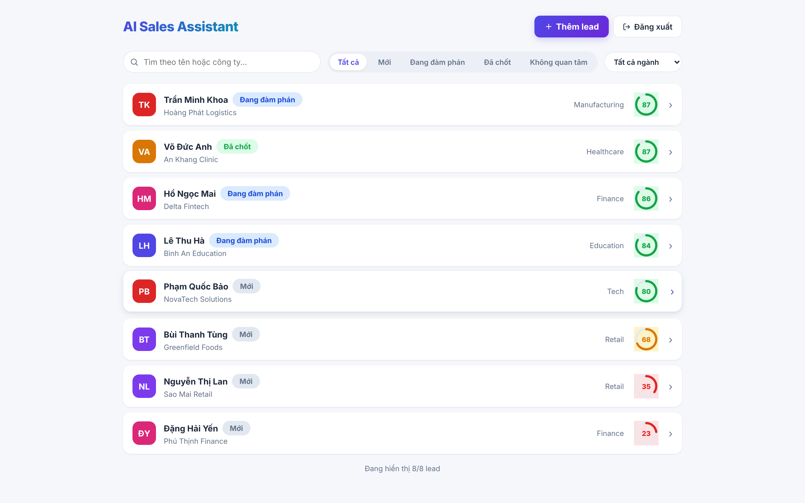
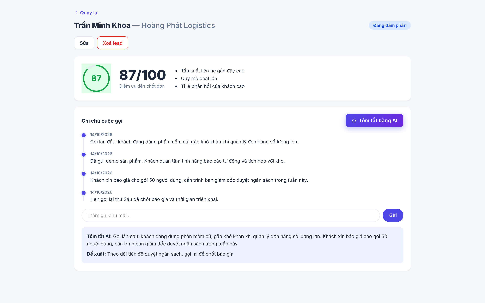

# AI Sales Assistant

A lead management tool for sales and telesales teams. It scores each lead by how likely it is to close, so reps know who to call first, and turns long call notes into a short summary with a suggested next step.

**Live demo:** [ai-sales-assistant-steel.vercel.app](https://ai-sales-assistant-steel.vercel.app) · [API docs](https://ai-sales-assistant-api-ulqe.onrender.com/docs)
Demo account: `demo@company.com` / `demo1234`, or register your own (each account has its own leads).

> The backend runs on Render's free tier and sleeps after ~15 minutes of inactivity, so the first request can take 20–30 seconds.

## Screenshots

Leads ranked by score, with filters by status and industry (UI is in Vietnamese):



Lead detail: the score with the main factors behind it, call notes, and an AI summary with a suggested next step:



## Why I built it

I spent a year as a sales team lead at an education company. Two problems came up every day: with hundreds of leads in the list, there was no objective way to decide who to call first, and writing up and re-reading call notes took a lot of time. This project tackles both.

## Features

- **Lead scoring**: a Random Forest model gives each lead a 0–100 score based on deal size, contact frequency, days since last contact, response rate, lead source and industry, and shows which factors drove the score.
- **Call note summaries**: condenses a lead's notes into 2–3 sentences and suggests the next action. Works out of the box with a built-in extractive summarizer (Vietnamese and English); set `OPENAI_API_KEY` to switch to an LLM, with automatic fallback if the API call fails.
- **Accounts**: JWT-based registration and login, with each user's leads kept separate.
- **Lead management**: create, edit, delete, search and paginate leads, and keep a note history per lead.

## Model

The scoring model is trained on synthetic data (4,000 leads) generated from rules based on real sales patterns, for example referrals and recently contacted leads convert more often, with random noise added. No real customer data is used.

| Metric | Test set (800 leads) |
|---|---|
| Accuracy | 0.72 |
| ROC-AUC | 0.79 |

With a company's real CRM history, the same pipeline can be retrained on actual outcomes.

## Tech stack

```
React (Vite)  →  FastAPI  →  scikit-learn model
                    ├──→  Summarizer (extractive / OpenAI)
                    └──→  SQLite (dev) / PostgreSQL (prod)
```

| Layer | Tools |
|---|---|
| Frontend | React 18, Vite, React Router, Axios |
| Backend | FastAPI, Pydantic, SQLAlchemy, JWT |
| ML | scikit-learn, pandas, NumPy |
| Testing | pytest, FastAPI TestClient |
| CI/CD | GitHub Actions |
| Hosting | Render (backend), Vercel (frontend) |

Requirements, use cases, architecture and wireframes are written up in [`docs/`](./docs) (in Vietnamese).

## Run locally

With Docker:

```bash
docker compose up --build
```

Frontend at http://localhost:5173, API and Swagger docs at http://localhost:8000/docs.

Without Docker:

```bash
# backend
cd backend
python -m venv .venv && source .venv/bin/activate   # Windows: .venv\Scripts\activate
pip install -r requirements.txt
python -m app.ml.train          # train the model once
uvicorn app.main:app --reload

# frontend (in another terminal)
cd frontend
cp .env.example .env
npm install
npm run dev
```

## Tests

```bash
cd backend
pytest -v
```

Covers auth, lead CRUD, the notes and summary flow, and the training pipeline. Tests run on every push via GitHub Actions.

## Deployment

- **Backend (Render)**: New → Blueprint → select this repo; Render reads `render.yaml`. Set `DATABASE_URL` to a Render PostgreSQL instance, since the free tier has no persistent disk and SQLite data is lost on restart. `OPENAI_API_KEY` is optional.
- **Frontend (Vercel)**: import the repo with `frontend` as the root directory and set `VITE_API_URL` to the backend URL.

## Project structure

```
├── backend/
│   ├── app/
│   │   ├── ml/            # data generation, training, prediction
│   │   ├── routers/       # auth, leads
│   │   └── summarizer.py  # note summarization
│   └── tests/
├── frontend/src/
│   ├── pages/             # Login, Register, Dashboard, LeadDetail
│   └── components/
├── docs/                  # requirements, use cases, architecture, wireframes
├── docker-compose.yml
└── render.yaml
```

## License

MIT
